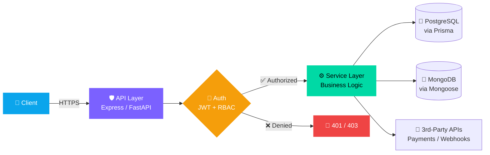

<!-- =========================================================
     🚀 GitHub Profile README — Rasibul Islam
     Copy everything into: github.com/Rasibul/Rasibul/README.md
========================================================= -->

<!-- 🌊 Animated Header -->
<p align="center">
  
</p>

<!-- ⌨️ Typing Animation -->
<p align="center">
  <a href="https://git.io/typing-svg">
    
  </a>
</p>

<!-- 🏷️ Quick Badges -->
<p align="center">
  <a href="mailto:rasibuldeveloper@gmail.com"></a>
  <a href="https://www.linkedin.com/in/rasibul-islam"></a>
  <a href="https://github.com/Rasibul"></a>
  
</p>

<p align="center">
  
  
  
</p>


## 👨‍💻 About Me

I'm a **backend-focused developer** who loves designing **secure, scalable and maintainable** systems. I turn complex business requirements into **clean APIs**, **reliable database structures** and **production-ready services**.

```ts
const rasibul = {
  role: "Backend Developer",
  location: "Bangladesh 🇧🇩",
  languages: ["TypeScript", "JavaScript", "Python", "C", "C++"],
  backend: ["Node.js", "Express.js", "FastAPI", "GraphQL"],
  databases: ["PostgreSQL", "MongoDB", "Prisma", "Mongoose"],
  currentlyBuilding: "Event Manager 🗓️",
  currentlyLearning: ["Microservices", "System Design", "Docker"],
  philosophy: "Good code solves a problem. Great code builds a system.",
  askMeAbout: ["Backend Dev", "API Architecture", "Databases", "Deployment"],
};
```

- 🔭 Currently building **Event Manager**
- ⚙️ Developing **REST & GraphQL APIs** and backend services
- 🔐 Experienced with **authentication, authorization, databases & deployment**
- 🐍 Comfortable in both **JavaScript/TypeScript** and **Python** ecosystems
- 📫 Reach me at **rasibuldeveloper@gmail.com**


## 🛠️ Tech Stack

<table align="center">
  <tr>
    <td align="center" width="170"><b>💻 Languages</b></td>
    <td></td>
  </tr>
  <tr>
    <td align="center"><b>⚙️ Backend</b></td>
    <td></td>
  </tr>
  <tr>
    <td align="center"><b>🗄️ Databases & ORMs</b></td>
    <td> </td>
  </tr>
  <tr>
    <td align="center"><b>🎨 Frontend</b></td>
    <td></td>
  </tr>
  <tr>
    <td align="center"><b>🧰 Tools & DevOps</b></td>
    <td></td>
  </tr>
  <tr>
    <td align="center"><b>🧪 Testing</b></td>
    <td>  </td>
  </tr>
</table>


## ⚡ Backend Expertise

| 🧩 Area | 🔍 What I Do |
|:--|:--|
| 🌐 **API Development** | RESTful & GraphQL APIs, versioning, validation, clean error handling |
| 🏗️ **Backend Architecture** | Modular, layered & scalable apps (controller → service → repository) |
| 🗄️ **Database Design** | Schema design, relations, indexing — MongoDB, PostgreSQL, Mongoose, Prisma |
| 🔐 **Security** | JWT auth, refresh tokens, password hashing (bcrypt), role-based access control |
| 🔗 **Integrations** | Third-party APIs, webhooks & payment gateways |
| 🚀 **Deployment** | Production builds, environment config, Docker & server setup |
| 🧪 **Testing** | Unit & integration tests with Jest, Supertest & Pytest |

## 🧠 How I Build Backends



## 🚀 Currently Exploring

<p align="center">
  
  
  
  
  
</p>


## 📊 GitHub Analytics

<p align="center">
  
  
</p>

<p align="center">
  
</p>

## 📈 Contribution Activity

<p align="center">
  
</p>

<details>
<summary><b>🏆 GitHub Trophies & Profile Summary (click to expand)</b></summary>
<br/>

<p align="center">
  
</p>

<p align="center">
  
</p>

<p align="center">
  
  
  
</p>

</details>


## 🤝 Connect With Me

<p align="center">
  <a href="https://www.linkedin.com/in/rasibul-islam" target="_blank"></a>
  <a href="https://facebook.com/rasibul.islam.754" target="_blank"></a>
  <a href="https://www.instagram.com/rasibul.islam.dev" target="_blank"></a>
  <a href="mailto:rasibuldeveloper@gmail.com"></a>
</p>

<p align="center">
  <i>💡 “Good code solves a problem. Great code builds a system.”</i>
</p>

<p align="center">
  <b>Thanks for visiting my profile 💚 — feel free to ⭐ a repo you like!</b>
</p>

<!-- 🌊 Animated Footer -->
<p align="center">
  
</p>
